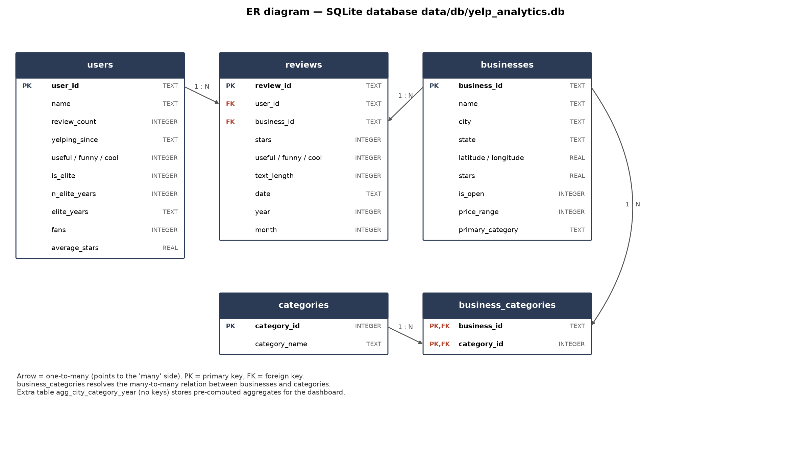
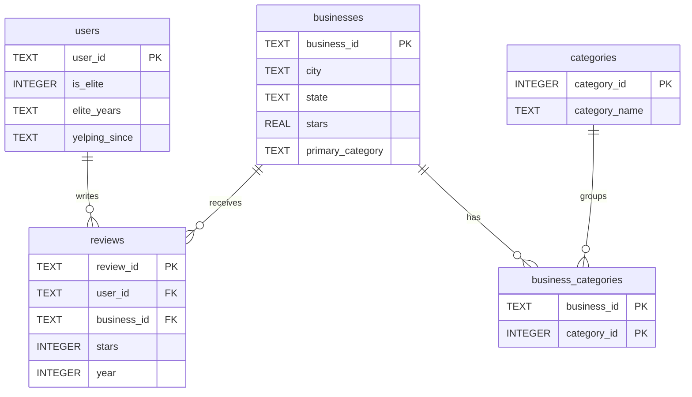

# Yelp Reviews at Scale: Ratings, Categories and Cities

Final project for **Programming for Data Analysis and Database** (MSc Applied Artificial Intelligence).
Topic #44, Cluster 8: Large-Scale Data Processing (Pandas, Polars, Dask, Parquet).

**Team:** Uali Sembay and Arystan Aldiyev (group AAI-2605)

The project streams the official [Yelp Open Dataset](https://business.yelp.com/data/resources/open-dataset/)
(JSON Lines) without unpacking the 4.3 GB archive. It converts the data to partitioned Parquet with
chunked processing and checks data quality. It then compares Pandas, Dask and Polars on the same
task, loads a normalised SQLite database (8 SQL queries), tests three hypotheses about ratings,
cities and Elite reviewers, and predicts a review's star rating from its text. The model
comparison uses a TF-IDF baseline and leakage-free chronological splits.

## Quick start

Requires Python 3.11+ (developed with 3.12) and about 3 GB of free disk space.

```bash
git clone <this-repository-url> yelp-reviews-at-scale
cd yelp-reviews-at-scale
python3 -m venv .venv
source .venv/bin/activate            # Windows: .venv\Scripts\activate
pip install -r requirements.txt

python main.py --auto                # full pipeline: download -> ETL -> benchmark -> SQL -> EDA -> models
python main.py                       # interactive console menu (options 0–9)
streamlit run app.py                 # dashboard with filters (year, city, category, Elite status)
python -m src.build_notebook         # rebuild and execute the analysis notebook
```

**Run time.** Expect 30–60 minutes for the first `--auto` run. Most of it is stage 1, which streams
the ~4.3 GB archive from Yelp once. Later runs reuse `data/raw/` and skip the download.

**Offline or manual download.** You can download `Yelp-JSON.zip` (or `yelp_dataset.tar`) yourself
and point the pipeline at it:
`YELP_ARCHIVE=/path/to/Yelp-JSON.zip python main.py --auto`.

The raw data, Parquet files, database and trained model are not committed to Git because of their
size (see `.gitignore`). They are rebuilt by `python main.py --auto`. The small result files in
`outputs/` are committed.

## Data

| File (data/raw) | Rows kept | How |
|---|---|---|
| `yelp_academic_dataset_business.json` | all ~150K businesses | streamed in full |
| `yelp_academic_dataset_review.json` | ~777K of ~7M reviews | **systematic sample: every 9th line** of the full file |
| `yelp_academic_dataset_user.json` | every user who wrote a sampled review (real records, including the real `elite` years) | streamed; the multi-GB `friends` list is dropped |

The full review file is grouped by business. Taking its first N lines would therefore cover only
about 15% of businesses. Taking every k-th line covers all of them while keeping more than the
500K rows the course requires. `data/raw/_extraction_manifest.json` records exactly what was kept.

## Pipeline

| Stage | Module | What it does |
|---|---|---|
| 1 | `src/data_download.py` | HTTP stream: ZIP raw deflate → gzip → tar, read line by line, with sampling and user filtering |
| 2 | `src/etl_pipeline.py` | Chunked JSONL reading (100K rows), data-quality audit (duplicates, empty text, invalid stars/dates, orphan keys, vote outliers, IQR), dtype optimisation with before/after memory, year-partitioned Parquet plus a single Parquet file written incrementally |
| 3 | `src/benchmarks.py` | One task in four engines: JSONL chunked baseline, Pandas, Dask (lazy) and Polars (lazy). Each runs in its own process; we record median time and peak RSS and check that the result tables are identical |
| 4 | `src/database.py`, `src/er_diagram.py` | SQLite schema with 5 tables and foreign keys, an aggregate table, an ER diagram and 8 queries (JOIN, GROUP BY/HAVING, CTE, subqueries, window functions RANK/LAG/NTILE/AVG OVER). Results are saved to `outputs/sql_results/*.csv` |
| 5 | `src/eda_analytics.py` | Descriptive statistics, 3 hypothesis tests with effect sizes, 7 static figures and 2 interactive Plotly figures |
| 6 | `src/ml_models.py` | Star prediction from text: majority baseline and TF-IDF+LogReg baseline, compared with BoW+NB, a larger TF-IDF+LinearSVC and LSA embeddings+LogReg. Split: train ≤2018, validation 2019, test ≥2020 |
| UI | `main.py`, `app.py` | Console menu and Streamlit dashboard |

## Database schema





## Repository layout

```
main.py                     console menu + `--auto` pipeline
app.py                      Streamlit dashboard
src/config.py               paths and settings
src/data_download.py        streamed extraction of the official archive
src/etl_pipeline.py         chunked ETL, audit, dtype optimisation, Parquet
src/benchmarks.py           Pandas vs Dask vs Polars vs JSONL baseline
src/database.py             SQLite schema, loading, 8 SQL queries
src/er_diagram.py           ER diagram drawing
src/eda_analytics.py        EDA, hypothesis tests, figures
src/ml_models.py            text models and evaluation
src/build_notebook.py       builds/executes the notebook
Yelp_Reviews_At_Scale_Analysis.ipynb
outputs/                    JSON results, SQL result CSVs, figures, aggregates
docs/                       written report (.docx) and presentation (.pptx)
```

## How the course requirements are met

| # | Requirement | Where |
|---|---|---|
| 1 | ≥5 functions besides `main` | Each module splits its stage into functions (e.g. `stream_jsonl_chunks`, `optimize_dataframe_dtypes`, `process_users`, `run_all_benchmarks`, `build_sqlite_database`, `run_statistical_hypotheses`, `train_and_evaluate_models`) |
| 2 | lists / dicts | Audit counters, the engine registry, the SQL query dictionary, menu options, result summaries |
| 3 | if / elif / else | Menu dispatch, cleaning rules, tier labels |
| 4 | loops | Chunk loops, streaming loops, the menu `while True`, the benchmark repeats |
| 5 | file I/O | JSONL read; JSON, CSV, Parquet, SQLite and joblib written |
| 6 | try / except | Malformed JSON lines, missing files, invalid menu input, empty review text |
| 7 | UI | `main.py` menu and `app.py` dashboard |
| 8 | modularity | `src/` package; standard library modules `json`, `pathlib`, `datetime`, `tarfile`, `zlib`, `sqlite3`, `multiprocessing` |
| 9 | approaches vs baseline | Engine benchmark (time, memory, result equality) and text-model comparison (quality, time, memory, size) |
| 10 | SQL | SQLite, ER diagram, 8 queries, results loaded into Pandas |
| 11 | volume | ~777K reviews and ~760 MB of raw JSONL; chunking, dtype optimisation and Parquet throughout |

## Team contributions

| Member | Main responsibilities |
|---|---|
| Uali Sembay | Streamed download and sampling, chunked ETL and data-quality audit, dtype optimisation and Parquet, engine benchmark, SQLite schema, ER diagram, SQL queries |
| Arystan Aldiyev | EDA and hypothesis tests, visualisations, text models and evaluation, console menu, Streamlit dashboard, notebook |
| Both | Report, presentation, code review and testing |

## Results

See `docs/FINAL_PROJECT_REPORT.docx` and the files in `outputs/`.
