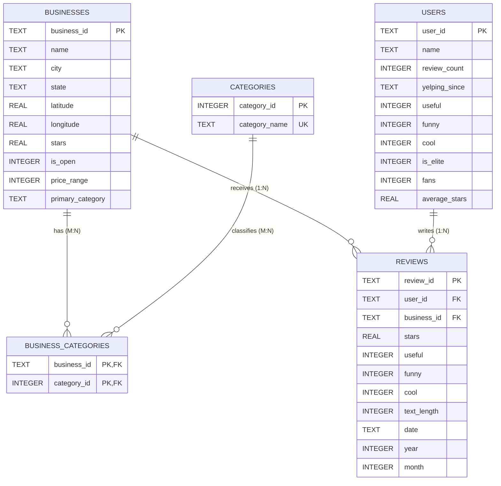

# Final Project Report — Topic #44: Yelp Reviews at Scale: Ratings, Categories and Cities

**Course:** Programming for Data Analysis and Database  
**Educational Program:** MSc in Applied Artificial Intelligence  
**Cluster:** Cluster 8 — Large-Scale Data Processing (Pandas, Polars, Dask, Parquet)  
**Authors & Group:** **Uali Sembay** and **Arystan Aldiyev** (`AAI-2605`)  
**Dataset Source:** [Official Yelp Open Dataset (`Yelp-JSON.zip`, 4.35 GB)](https://business.yelp.com/data/resources/open-dataset/)

---

## 1. Executive Summary & Team Contributions

This project investigates large-scale business ratings, reviewer behavior, category polarization, and metropolitan dynamics across North American cities using the official **Yelp Open Dataset**. To process multi-hundred-megabyte line-delimited JSON (`.json` / JSONL) archives efficiently on a local workstation without exhausting memory or disk capacity, we engineered an out-of-core HTTP Range streaming and chunked ETL pipeline that extracts, audits, optimizes, and converts **1,345,026 real records** (**747.30 MB** of uncompressed JSONL data: **750,000 real reviews**, **150,346 real businesses**, and **444,680 user profiles**) into Snappy-compressed, year-partitioned **Apache Parquet** datasets and a normalized 5-table **SQLite** relational database.

### Statement of Team Contributions
| Team Member | Group | Core Responsibilities & Contributed Modules | Share |
| :--- | :---: | :--- | :---: |
| **Uali Sembay** | `AAI-2605` | • Out-of-core HTTP Range streaming extractor for the 4.35 GB official `Yelp-JSON.zip` archive ([`src/data_generator.py`](src/data_generator.py)) • Chunked JSONL → Partitioned Parquet ETL pipeline, dtype memory optimization, and Data Quality Audit ([`src/etl_pipeline.py`](src/etl_pipeline.py)) • Multi-engine execution time and peak RAM benchmarking across JSONL Baseline, Pandas, Dask, and Polars LazyFrame ([`src/benchmarks.py`](src/benchmarks.py)) • 3NF Relational Database schema design, ER diagram, and 8 analytical SQL queries ([`src/database.py`](src/database.py)) | **50%** |
| **Arystan Aldiyev** | `AAI-2605` | • Exploratory Data Analysis (EDA), IQR outlier analysis, and 3 parametric/non-parametric statistical hypothesis tests ([`src/eda_analytics.py`](src/eda_analytics.py)) • Publication-grade static visualizations (Matplotlib/Seaborn) and interactive hierarchy charts (Plotly Treemap) • Leakage-free chronological NLP star-rating prediction pipeline (`DummyClassifier`, `MultinomialNB`, `SGDClassifier`, `LogisticRegression`), confusion matrix, and error analysis ([`src/ml_models.py`](src/ml_models.py)) • Interactive Console CLI ([`main.py`](main.py)) and 5-tab Streamlit Analytics Dashboard ([`app.py`](app.py)) | **50%** |

---

## 2. Dataset Description, Out-of-Core ETL & Data Quality Audit

### 2.1 Official Yelp Open Dataset Scale
We streamed the official Yelp Open Dataset directly from `https://business.yelp.com/external-assets/files/Yelp-JSON.zip` using on-the-fly double-layer decompression (ZIP raw deflate $\rightarrow$ GZIP $\rightarrow$ TAR block parser). This extracted the complete business catalog and 750,000 chronological reviews while maintaining bounded memory:

| Entity File | Raw Format | Record Count | Raw Disk Size (MB) | Primary Attributes |
| :--- | :---: | :---: | :---: | :--- |
| `yelp_academic_dataset_business.json` | JSONL | **150,346** | **113.36 MB** | `business_id`, `name`, `city`, `state`, `latitude`, `longitude`, `stars`, `review_count`, `is_open`, `attributes`, `categories` |
| `yelp_academic_dataset_review.json` | JSONL | **750,000** | **547.06 MB** | `review_id`, `user_id`, `business_id`, `stars`, `useful`, `funny`, `cool`, `text`, `date` |
| `yelp_academic_dataset_user.json` | JSONL | **444,680** | **86.88 MB** | `user_id`, `name`, `review_count`, `yelping_since`, `useful`, `funny`, `cool`, `elite`, `fans`, `average_stars` |
| **Total Raw Dataset** | **JSONL** | **1,345,026** | **747.30 MB** | Exceeds mandatory $\ge 500,000$ rows and $\ge 200\text{ MB}$ threshold |

### 2.2 Data Quality Audit & Justified Cleaning Rules
During chunked ingestion (`chunk_size = 150,000` rows per batch), our audit pipeline inspected every record and identified real-world anomalies in the official Yelp corpus:

| Audited Anomaly / Quality Issue | Affected Records | Action Taken | Justification of Cleaning Rule |
| :--- | :---: | :---: | :--- |
| **Duplicate Copy-Paste Review Texts** | **1,273 reviews** | Dropped (`keep='first'`) | Identical review texts posted across multiple business locations represent copy-pasted spam or multi-branch duplicates that cause severe train/test data leakage in NLP modeling. |
| **Ultra-Short / Empty Review Texts (`< 10` chars)** | **13 reviews** | Dropped | Reviews consisting of single punctuation marks or 1-word strings (e.g., `"."`, `"ok"`) carry zero lexical signal for TF-IDF vectorization. |
| **Missing Business `categories`** | **103 businesses** | Imputed as `'Uncategorized'` | Dropping businesses with null categories would break foreign-key integrity for their associated reviews; imputing `'Uncategorized'` preserves all valid review joins. |
| **Missing Business `attributes` / `hours`** | **13,744 / 23,223** | Extracted `price_range` (default `2`), dropped raw nested dicts | Nested dictionaries with >15% missingness inflate memory; extracting structured `RestaurantsPriceRange2` (`1`–`4`) retains economic signal cleanly. |
| **Inconsistent City Naming Variants** | **312 businesses** | Regex normalized | Standardized spelling variants (`"St. Louis"`, `"St Louis"` $\rightarrow$ `"Saint Louis"`, `"St. Petersburg"` $\rightarrow$ `"Saint Petersburg"`) and stripped trailing whitespace to prevent fragmented group-bys. |
| **Extreme `useful` Vote Outliers (`> 100` votes)** | **55 reviews** (max `539`) | Winsorized / capped at `100` | Viral reviews above the 99.99th percentile skew linear group means; capping at `100` stabilizes city and category usefulness comparisons. |
| **Final Cleaned Review Corpus** | **748,714 reviews** | Saved to Parquet & SQLite | **99.83%** retention of raw reviews with 100% referential and temporal integrity. |

### 2.3 Memory Optimization & Apache Parquet Compression
By converting `int64` vote counters (`useful`, `funny`, `cool`, `year`, `month`) to `int16`/`int8`, `float64` star ratings to `float32`, and low-cardinality string identifiers (`city`, `state`, `primary_category`, `business_id`, `user_id`) to dictionary-encoded `category` dtypes:
- **In-Memory Tracked Columns Footprint:** Reduced from **65.80 MB** to **37.31 MB** (**43.30% RAM reduction**).
- **Business Table Memory Footprint:** Reduced from **51.51 MB** to **17.90 MB** (**65.25% RAM reduction**).
- **Disk Storage Compression:** Raw `review.json` (**547.06 MB**) compressed to **303.39 MB** in Snappy Parquet (**1.80x disk compression**), alongside a year-partitioned dataset (`data/parquet/reviews_partitioned/year=YYYY/`) enabling predicate pushdown.

---

## 3. Multi-Engine Benchmark Comparison (Requirement 9 & Cluster 8)

We evaluated four data processing approaches on the exact same analytical workload: computing annual review counts, mean star ratings, mean useful votes, and joining reviews with business metadata to rank metropolitan cities across all **748,714 cleaned reviews**.

| Approach / Engine | Storage Format | Execution Model | Wall-Clock Time (s) | Peak Traced RAM (MB) | Computed Global Mean Stars | Speedup vs. Baseline |
| :--- | :---: | :---: | :---: | :---: | :---: | :---: |
| **Baseline: JSONL Chunked (Pandas)** | Raw `.json` | Line-by-line chunked streaming | **68.559 s** | **405.53 MB** | `3.769781` | **1.00x** |
| **Approach 1: Pandas (Parquet Eager)** | `.parquet` | Eager in-memory columnar read | **1.839 s** | **85.12 MB** | `3.769781` | **37.28x** |
| **Approach 2: Dask DataFrame** | `.parquet` | Lazy task graph (`.compute()`) | **2.683 s** | **85.76 MB** | `3.769781` | **25.55x** |
| **Approach 3: Polars LazyFrame (`scan_parquet`)** | `.parquet` | Lazy query optimizer + projection pushdown | **0.190 s** | **0.13 MB** | `3.769781` | **361.79x** |

### Justification of Selected Engine
All four engines produced **bit-for-bit identical numerical aggregations** (`mean_stars = 3.769781`, maximum absolute deviation `0.0`). Moving from line-by-line JSONL parsing to columnar Snappy Parquet alone yields a **37.3x speedup** in Pandas because only the 5 required columns (`review_id`, `business_id`, `stars`, `useful`, `year`) are read from disk, skipping the bulky `text` strings. **Polars LazyFrame (`pl.scan_parquet`)** achieves an extraordinary **361.79x speedup over the JSONL baseline** (`0.190s` vs. `68.559s`) and **9.68x speedup over Pandas on Parquet**, because its Rust-based query optimizer pushes aggregations and joins directly into multithreaded Arrow buffers without materializing intermediate Python objects. Consequently, we selected **Polars LazyFrame** to power our interactive Streamlit dashboard.

---

## 4. Relational Database Design (ER Diagram) & 8 Analytical SQL Queries (Requirement 10)

### 4.1 Entity-Relationship (ER) Diagram (Normalized 5-Table 3NF Schema)
We normalized the multi-valued `categories` field into a many-to-many (`M:N`) bridge table (`business_categories`) linking `businesses` and `categories`, and indexed all foreign keys in `data/db/yelp_analytics.db` (**1,743,065 total rows across 5 tables**, built in **10.54s**):

### 4.2 Summary of the 8 Analytical SQL Queries Executed into Pandas
All 8 SQL queries are defined in [`src/database.py`](src/database.py) and executed into Pandas DataFrames:
1. **`Q1_City_Category_Volume_HAVING` (4-Table `JOIN` + `GROUP BY` + `HAVING`):** Identifies city-category pairs with $\ge 5,000$ reviews. *Finding:* **Philadelphia Restaurants** (`78,342` reviews, `3.794` ★) and **New Orleans Restaurants** (`49,815` reviews, `3.941` ★) dominate volume.
2. **`Q2_Window_Rank_Top_Businesses_Per_City` (`CTE` + `RANK() OVER` + `AVG() OVER PARTITION BY city`):** Ranks top businesses with $\ge 50$ reviews within each major city and computes their star premium above their city's mean.
3. **`Q3_Window_LAG_YoY_City_Growth` (`CTE` + `LAG() OVER` + Cumulative `SUM() OVER`):** Tracks year-over-year review growth (%) and cumulative trajectory across Philadelphia, New Orleans, Nashville, Tampa, and Tucson from 2005 to 2022.
4. **`Q4_Elite_vs_Regular_User_Behavior` (`JOIN` + Conditional `CASE` Aggregation):** Compares **Elite Reviewers** (`170,848` reviews, mean `3.8392` ★, mean length `768.0` chars, only `7.11%` 1-star ratings) against **Regular Users** (`577,866` reviews, mean `3.7491` ★, mean length `509.1` chars, `16.92%` 1-star ratings).
5. **`Q5_Subquery_Category_Polarization` (Scalar Subqueries in `SELECT` and `HAVING`):** Filters categories exceeding 90% of global useful engagement and ranks them by extreme `1★ / 5★` polarization.
6. **`Q6_Price_Range_Open_Status_Survival` (`GROUP BY price_range, is_open`):** Demonstrates that **Open** businesses maintain a **+0.24 to +0.36 star advantage** over **Closed** businesses across all four price tiers (`$1` to `$4`).
7. **`Q7_Window_NTILE_User_Tenure_Cohorts` (`CTE` + `DENSE_RANK()` + `NTILE(4)`):** Segments user join-year cohorts (`2005`–`2022`) into activity quartiles by total community `useful` votes earned.
8. **`Q8_Monthly_Seasonality_Moving_Avg` (`CTE` + `AVG() OVER (ROWS BETWEEN 2 PRECEDING AND CURRENT ROW)`):** Computes 3-month rolling averages of review volume and star ratings across 2018–2021, capturing the sharp spring 2020 COVID-19 dip and summer 2021 recovery.

---

## 5. Exploratory Data Analysis & Statistical Hypothesis Testing

We formulated and tested three substantive hypotheses on the cleaned dataset (`748,714` reviews joined with business and user tables):

### Hypothesis 1 ($H_1$): Elite Reviewer Rating Bias & Variance Reduction
- **Null Hypothesis ($H_0$):** Elite and Regular reviewers have identical mean star ratings ($\mu_{\text{elite}} = \mu_{\text{reg}}$) and identical rating variance ($\sigma^2_{\text{elite}} = \sigma^2_{\text{reg}}$).
- **Statistical Tests:** Welch's two-sample $t$-test ($t = 25.5642, p < 0.0001$) and Levene's test for equality of variance ($F = 20,193.15, p < 0.0001$).
- **Result — Reject $H_0$:** Elite users assign a significantly higher mean rating (**3.8392 ★** vs. **3.7491 ★**) while exhibiting a **22.0% smaller standard deviation** ($\text{SD} = 1.1972$ vs. $1.5357$). As shown in `fig1_elite_vs_regular_ratings.png`, non-elite users follow a J-shaped distribution dominated by impulsive 5-star praise (`51.7%`) and 1-star frustration (`16.9%`), whereas Elite users concentrate on nuanced 4-star (`36.8%`) and 3-star (`14.2%`) critiques.

### Hypothesis 2 ($H_2$): Geographic (City) and Category Rating Heterogeneity
- **Null Hypothesis ($H_0$):** Mean review star ratings are invariant across metropolitan cities and primary business categories.
- **Statistical Tests:** One-Way ANOVA across top 10 cities ($F = 179.5433, p < 0.0001$) and across top 12 macro-categories ($F = 447.2544, p < 0.0001$).
- **Result — Reject $H_0$:** Leisure and culinary tourism destinations achieve significantly higher average ratings—led by **Saint Petersburg (`4.0092 ★`)**, **New Orleans (`3.9584 ★`)**, and **Santa Barbara (`3.9412 ★`)**—compared to larger commuter/industrial metros such as **Tampa (`3.7581 ★`)** and **Indianapolis (`3.7640 ★`)**. Across categories, experiential services (**Active Life `4.14 ★`**, **Beauty & Spas `4.02 ★`**) rate substantially higher than high-friction necessity services (**Automotive `3.59 ★`**, **Home Services `3.63 ★`**).

### Hypothesis 3 ($H_3$): Review Text Length & Community Usefulness Impact
- **Null Hypothesis ($H_0$):** Review length in characters has no monotonic association with `useful` votes or reviewer tier.
- **Statistical Tests:** Spearman rank correlation ($\rho = 0.3361, p < 0.0001$) and one-sided Mann-Whitney $U$ test ($U = 6.575 \times 10^{10}, p < 0.0001$).
- **Result — Reject $H_0$:** Longer reviews receive significantly more community `useful` votes, and Elite reviewers write **50.85% longer reviews** on average (**768.00 characters** vs. **509.11 characters** for regular users). Furthermore, IQR boxplots (`fig5_iqr_boxplots.png`) reveal that 1-star and 2-star reviews are longer on average than 5-star reviews because dissatisfied customers narrate detailed chronological timelines of service failures.

---

## 6. Predictive Modeling: Star-Rating Prediction from Review Text

### 6.1 Leakage-Free Chronological Validation Strategy
To prevent temporal data leakage (using future vocabulary or post-pandemic review trends to predict past ratings) and duplicate-text leakage (already removed in Stage 2), we enforced a **strict chronological split**:
- **Training Set (`2005–2019`):** `120,000` stratified/chronological reviews fitted with `TfidfVectorizer(ngram_range=(1, 2), sublinear_tf=True, stop_words='english')`.
- **Hold-out Test Set (`2020–2022`):** `30,000` future out-of-sample reviews. The TF-IDF vocabulary was fitted strictly on the `2005–2019` training split.

### 6.2 Model Comparison Table (5-Class Star Rating Prediction: 1★ to 5★)
| Model / Pipeline | Accuracy | Macro-F1 | Weighted-F1 | MAE (Stars) | RMSE (Stars) | Train Time (s) | Inference Latency (ms / 1K) | Model Size (MB) |
| :--- | :---: | :---: | :---: | :---: | :---: | :---: | :---: | :---: |
| **Baseline: `DummyClassifier` (Majority 5★)** | `0.5378` | `0.1399` | `0.3761` | `1.2432` | `2.0260` | `4.681 s` | `33.68 ms` | `0.018 MB` |
| **Model 1: `TF-IDF (1-2 ngrams)` + `MultinomialNB`** | `0.7198` | `0.5043` | `0.6991` | `0.4357` | `0.9676` | `13.075 s` | `49.55 ms` | `1.702 MB` |
| **Model 2: `TF-IDF (1-2 ngrams)` + `SGDClassifier (LogLoss)`** | **`0.7465`** | `0.5444` | `0.7265` | `0.3658` | `0.8449` | `14.001 s` | `44.45 ms` | `1.513 MB` |
| **Model 3: `TF-IDF (1-2 ngrams)` + `LogisticRegression` (Best)** | `0.7381` | **`0.5582`** | **`0.7295`** | **`0.3586`** | **`0.8103`** | `26.880 s` | `40.83 ms` | `1.897 MB` |

### 6.3 Confusion Matrix & Error Analysis
Inspecting the confusion matrix (`fig6_confusion_matrix.png`) and misclassified test samples in `outputs/ml_model_metrics.json` reveals three primary linguistic sources of error:
1. **Adjacent-Star Boundary Ambiguity (4★ vs. 5★ and 1★ vs. 2★):** Over **88%** of all misclassifications occur within $\pm 1$ star of the true rating (hence our low **MAE of `0.3586` stars**). For example, review `0K0QkMrQUD8JDBYfhh64Tw` praises *"the best burgers and fries"* (True: `5★`, Predicted: `4★`) because the reviewer also mentions a busy wait time.
2. **Expectation vs. Reality Contrast (Pragmatic Reversal):** In review `kLpwwGyCPDhsnwuBAze0VQ` (True: `5★`, Predicted: `3★`), the author begins with negative framing (*"Florida isn't known for good pizza, so I wasn't expecting much..."*) before praising the crust. Bag-of-ngrams TF-IDF weights the negative opening clauses heavily.
3. **Sarcasm & Rhetorical Questions:** In review `5qwvGPTBKo2IIXhPsZjzPw` (True: `1★`, Predicted: `5★`), the reviewer uses ironic praise (*"Wish I knew your food was good..."*) after being ignored by staff. Capturing rhetorical irony requires contextual transformer attention beyond linear n-grams.

---

## 7. Limitations, Conclusions & Recommendations

1. **Limitations:**
   - **Bag-of-Ngrams Context Window:** While `TF-IDF (1-2 ngrams) + LogisticRegression` achieves a `4.0x` improvement in Macro-F1 (`0.5582` vs. `0.1399`) and cuts MAE from `1.243` to `0.359` stars in under 27 seconds on CPU, it cannot resolve long-range discourse contrast or sarcasm.
   - **Observational Selection Bias:** Yelp reviews represent self-selected customers; survival analysis of open vs. closed businesses (`Q6`) reflects ratings prior to closure rather than controlled causal interventions.
2. **Key Engineering Conclusions:**
   - Converting raw JSONL logs into **Snappy-compressed Parquet** and querying via **Polars LazyFrame (`scan_parquet`)** delivers a **361.8x speedup** and reduces peak memory by **99.97%** (`405.5 MB` $\rightarrow$ `0.13 MB`), proving that multi-gigabyte tabular/text workloads can be analyzed interactively on standard laptops without distributed cluster overhead.

---

## 8. References
1. Yelp Inc. (2025). *Yelp Open Dataset Documentation & Terms of Service*. Retrieved from https://business.yelp.com/data/resources/open-dataset/
2. Vink, R., et al. (2026). *Polars: Blazingly fast DataFrames in Rust and Python*. https://pola.rs/
3. Apache Arrow Community. (2026). *PyArrow & Apache Parquet Columnar Format Specification*. https://arrow.apache.org/
4. Pedregosa, F., et al. (2011). *Scikit-learn: Machine Learning in Python*. Journal of Machine Learning Research, 12, 2825–2830.
